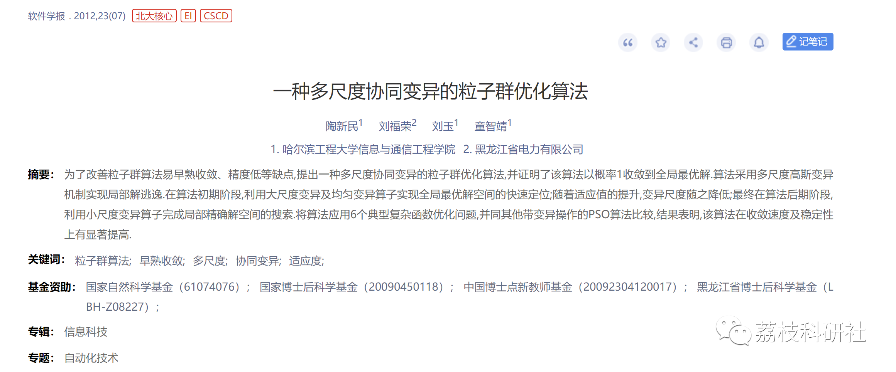
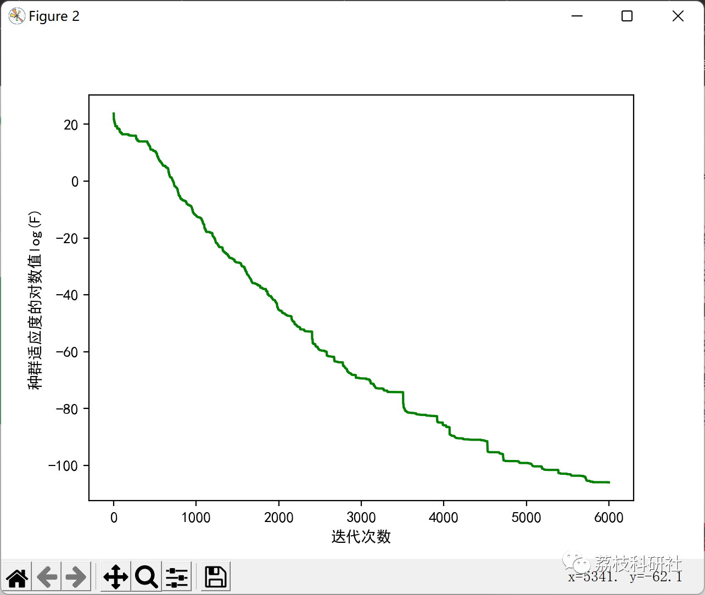
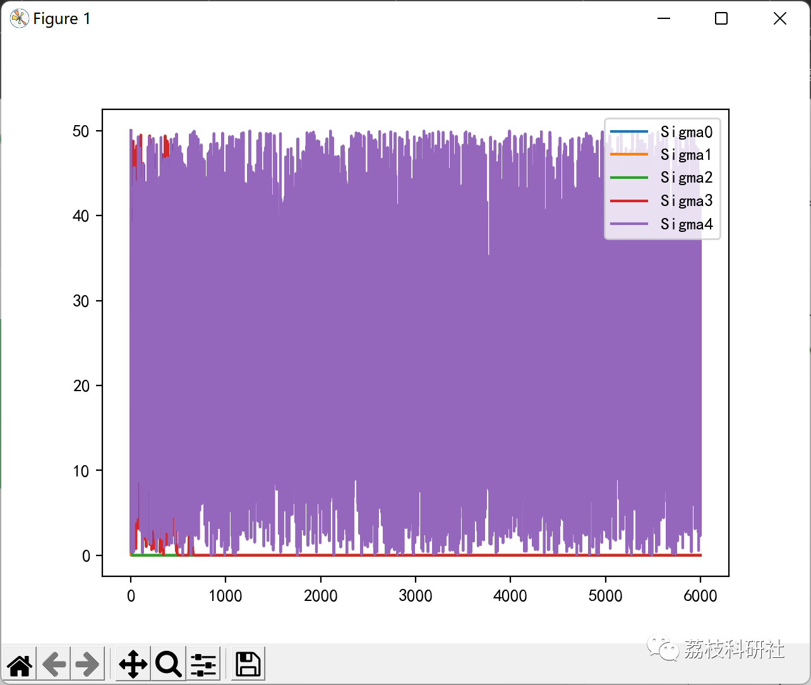

# A Multi-Scale Cooperative Variation Particle Swarm Optimization Algorithm (Python Code Implementation)

💥💥💥💞💞💞 Welcome to this blog❤️❤️❤️💥💥💥
🏆 Bloggers' Advantages: 🌞🌞🌞 The content of the blog strives for rigorous thinking and clear logic to facilitate readers.
⛳️ Mantra: A journey of a thousand miles begins with a single step.
Litchi Research Society
Code Collection: Power Systems, Intelligent Algorithms and Applications, Neural Network Prediction, Path Planning, Optimized Scheduling, Workshop Scheduling, Image Processing, Signal Processing...
🎁 Special Section Link: ​
🌈🌈🌈🌟🌟🌟🌟 Electrical Code Intelligent Algorithms and Their Applications Path Planning Neural Network Prediction Optimized Scheduling Image Processing Workshop Scheduling Signal Processing Romantic Her Thoughts My Philosophy Math Modeling Complete Code Issues
Directory:  
💥1 Literature Source
📚2 Overview
🎉3 Running Results
🌈4 Python Code Implementation
💥1 Literature Source
📚2 Overview
To improve the premature convergence and low accuracy of the Particle Swarm Optimization (PSO) algorithm, a multi-scale collaborative mutation PSO algorithm is proposed, which proves that the algorithm converges to the global optimal solution with a probability of 1. The algorithm employs a multi-scale Gaussian mutation mechanism to achieve local escape from solutions. In the initial stage of the algorithm, large scale mutation and uniform mutation operators are used to quickly locate the global optimal solution space; as the fitness value increases, the mutation scale decreases; finally, in the late stage of the algorithm, small scale mutation operators complete the search for the local precise solution space. The algorithm is applied to six typical complex function optimization problems and compared with other PSO algorithms with mutation operations. The results show that the algorithm has significantly improved in convergence speed and stability.
🎉3 Running Results
🌈4 Python Code Implementation
Click the article's lower left corner to read more.

## Images

<!-- PAYMENT_BLOCK -->

## Get this dataset

- Payment link (Stripe): [Buy now](https://buy.stripe.com/3cs8yP7sY87d0vu9AB)
- Payment QR code: 

<!-- /PAYMENT_BLOCK -->
